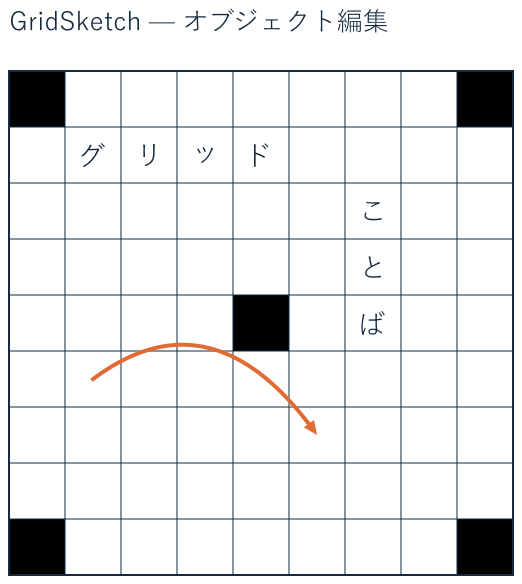

# GridSketch

GridSketch は、方眼紙やクロスワード、将棋盤などのマス目を使ったレイアウトを作れる Windows 用アプリです。マスごとに色や文字を入れたり、罫線を引いたり、画像や図形を重ねたりできます。作成したレイアウトは PNG や PDF に書き出せます。

## ダウンロードと起動

**[GridSketch v1.2.0 をダウンロード（Windows x64・ZIP）](https://github.com/izmktr/GridSketch/releases/download/v1.2.0/GridSketch-v1.2.0-win-x64.zip)**

1. ダウンロードした ZIP を右クリックして「すべて展開」を選びます。
2. 展開したフォルダにある `GridSketch\GridSketch.exe` を起動します。

.NET Desktop Runtime は同梱されています。ほかのバージョンは [リリース一覧](https://github.com/izmktr/GridSketch/releases)からダウンロードできます。

## 最初に試す

- 新しく作るには「ファイル → 新規」を選び、方眼紙などのプリセットから始めます。
- 完成例を編集するには、[サンプルプロジェクト](https://raw.githubusercontent.com/izmktr/GridSketch/main/examples/objects-sample.gridsketch)をダウンロードし、GridSketch の「ファイル → 開く」で読み込みます。

詳しい操作方法やソースからの起動手順は [操作・開発の詳細](README-details.md)を参照してください。
